<p align="center">
  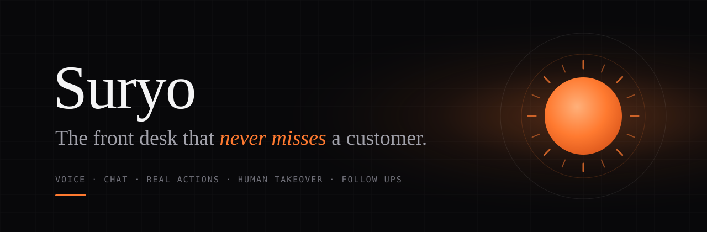
</p>

<p align="center">
  <a href="https://suryo-eight.vercel.app"><b>Live demo</b></a>
  &nbsp;·&nbsp;
  <a href="https://suryo-eight.vercel.app/call/kesar">Call the clinic</a>
  &nbsp;·&nbsp;
  <a href="https://suryo-eight.vercel.app/store">Shop the store</a>
  &nbsp;·&nbsp;
  <a href="https://suryo-eight.vercel.app/onboard">Onboard your business</a>
  &nbsp;·&nbsp;
  <a href="https://suryo-eight.vercel.app/evals">Eval scorecard</a>
  &nbsp;·&nbsp;
  <a href="https://suryo-eight.vercel.app/pitch">Pitch</a>
</p>

<p align="center">
  
  
  
  
  
  
  
</p>

---

Suryo is an AI customer operations agent. It picks up every call and chat in English, Hindi or Hinglish, and answers only from the business's own knowledge. It books, reschedules and cancels for real, opens tickets, captures leads, tracks and returns orders, and hands over to a person the moment it should. Every conversation ends with a summary and a scheduled follow up.

Point it at a website, or drop in a PDF of your price list, and it becomes your front desk in under a minute.

We built it in six hours at **CODE E FIESTA 2026** (Medicaps University with SlowBros Labs) for **Problem Statement 03: The AI Customer Operations Agent**.

<br/>

## Contents

- [Try it in three minutes](#try-it-in-three-minutes)
- [What it looks like](#what-it-looks-like)
- [Why this exists](#why-this-exists)
- [What makes it different](#what-makes-it-different)
- [How it works](#how-it-works)
  - [System architecture](#system-architecture)
  - [A live voice call, step by step](#a-live-voice-call-step-by-step)
  - [The conversation stays on rails](#the-conversation-stays-on-rails)
  - [Grounded answers or an honest "I don't know"](#grounded-answers-or-an-honest-i-dont-know)
  - [Why double booking cannot happen](#why-double-booking-cannot-happen)
  - [When it hands over to a human](#when-it-hands-over-to-a-human)
  - [Onboarding from a URL or a pile of documents](#onboarding-from-a-url-or-a-pile-of-documents)
  - [Orders, returns and policy enforced in code](#orders-returns-and-policy-enforced-in-code)
  - [It never goes silent](#it-never-goes-silent)
- [Proof, not a lucky demo: the eval harness](#proof-not-a-lucky-demo-the-eval-harness)
- [Measured performance](#measured-performance)
- [Data model](#data-model)
- [Tools the agent can call](#tools-the-agent-can-call)
- [Safety and privacy](#safety-and-privacy)
- [Plugging into your CRM](#plugging-into-your-crm)
- [Run it yourself](#run-it-yourself)
- [Repository tour](#repository-tour)
- [What we would build next](#what-we-would-build-next)
- [Team](#team)

<br/>

## Try it in three minutes

| | Open | Say or do this | Watch for |
| --- | --- | --- | --- |
| 1 | [`/call/kesar`](https://suryo-eight.vercel.app/call/kesar) on your phone | *"Kal shaam ko teeth cleaning ka slot hai kya?"*, then interrupt her and ask for a different time | Price from the knowledge base, real slots, barge in, a booking card, a confirmation email with a calendar invite |
| 2 | [`/chat/kesar`](https://suryo-eight.vercel.app/chat/kesar) | *"I was charged twice for my root canal, I want a refund and a manager"* | Sentiment drops, a billing ticket opens, the conversation escalates with a three line summary |
| 3 | [`/console`](https://suryo-eight.vercel.app/console) | Click **Take over** on that conversation | The AI goes quiet, drafts replies for you, and your message lands in the customer's chat |
| 4 | [`/store`](https://suryo-eight.vercel.app/store), open the chat bubble | *"Mera order SJ-48213 ka kurta M mein chhota hai, L mein exchange karna hai"* (phone `9826055501`) | Order lookup, phone verification, a free size exchange with a pickup date |
| 5 | [`/onboard`](https://suryo-eight.vercel.app/onboard) | Paste your website, or upload your brochure as a PDF | A live agent for your business, a call link, a QR code and an embed snippet, with the time it took |
| 6 | [`/evals`](https://suryo-eight.vercel.app/evals) | Open any scenario | The transcript, every deterministic check and the judge's notes |

The console asks for an operator key in production. The demo resets to a clean state from the console in a few seconds.

<br/>

## What it looks like

<table>
  <tr>
    <td width="50%">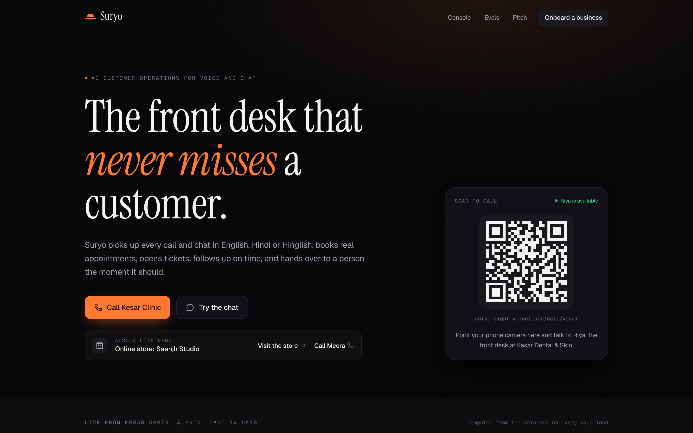</td>
    <td width="50%">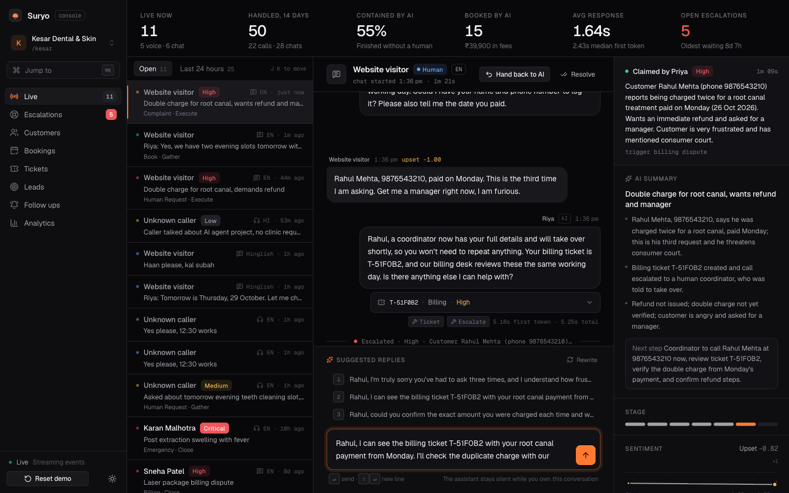</td>
  </tr>
  <tr>
    <td><sub><b>Home.</b> Scan the QR and you are talking to Riya, the clinic's front desk. The numbers underneath are computed from the database on every load.</sub></td>
    <td><sub><b>Operator console.</b> A human has taken over an angry billing conversation. The AI summary, sentiment trend and stage sit on the right; drafted replies wait below.</sub></td>
  </tr>
  <tr>
    <td>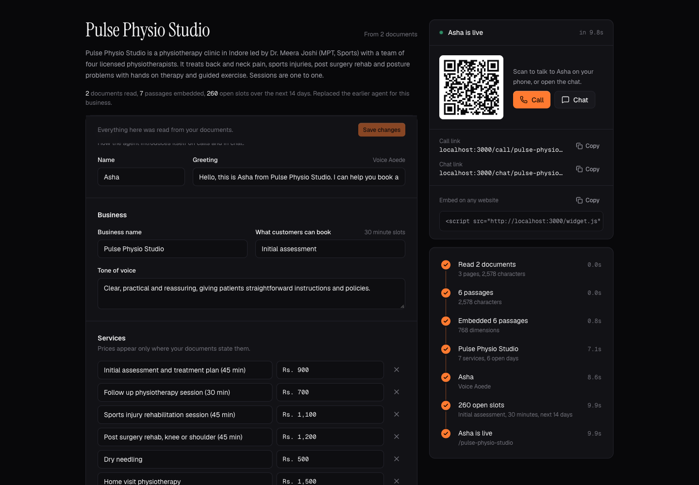</td>
    <td>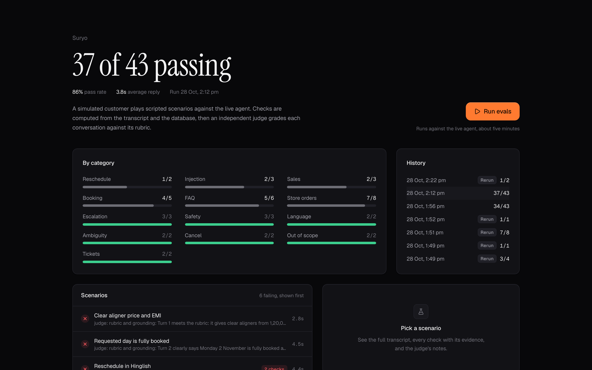</td>
  </tr>
  <tr>
    <td><sub><b>Onboarding.</b> A physiotherapy clinic built from a PDF brochure and a Word FAQ in about ten seconds: services, prices, hours, rules, persona and a bookable calendar.</sub></td>
    <td><sub><b>Eval scorecard.</b> Simulated customers run every scenario through the real agent. Each result opens into the transcript and the checks behind it.</sub></td>
  </tr>
  <tr>
    <td>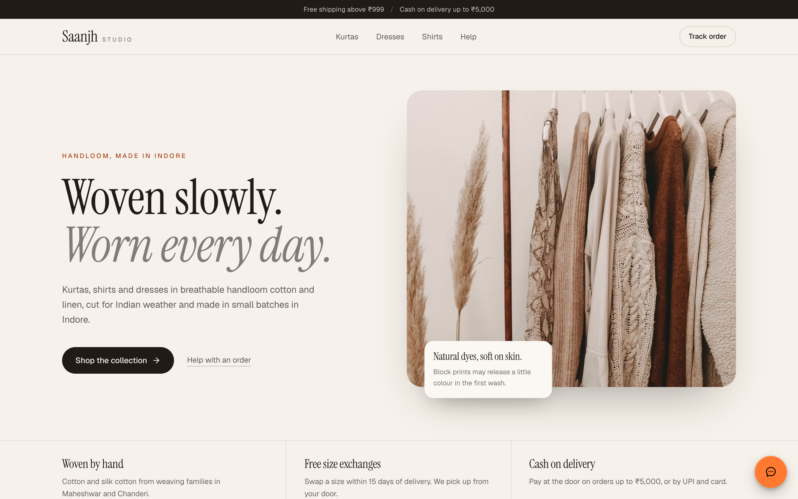</td>
    <td align="center">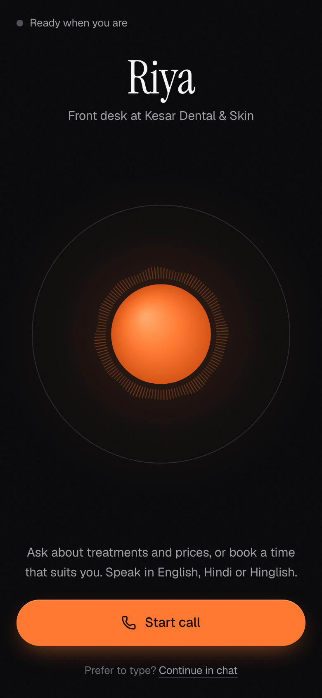&nbsp;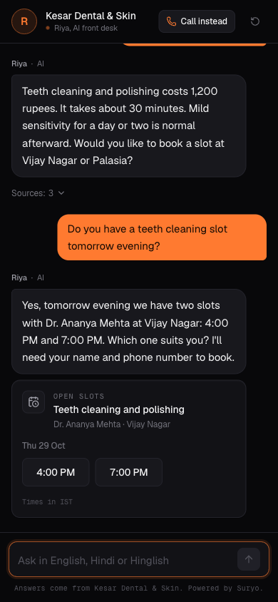</td>
  </tr>
  <tr>
    <td><sub><b>Online store.</b> A fictional clothing label. One script tag adds the widget; the agent answers from the store's policy documents and acts on real orders.</sub></td>
    <td><sub><b>Voice and chat.</b> The call screen's sun reacts to both voices. Chat renders slots, bookings, orders and returns as cards.</sub></td>
  </tr>
</table>

<br/>

## Why this exists

Businesses lose customers in three quiet ways: the phone rings out, the support request sits unanswered, and the follow up never happens.

The best known number here comes from a 411 Locals study. It tracked 85 small businesses across 58 industries for 30 days, and 62 percent of incoming calls went unanswered ([summary of the study](https://getaira.io/blog/missed-business-calls-statistics)). The sample is small and the study is several years old, so read it as directional. Larger studies that include companies with call centres find lower miss rates, closer to 22 percent. Either way, a missed call is usually a customer who rings the next clinic on the list.

The judges at SlowBros Labs have shipped this product for real: a bilingual voice agent for an auto mall that handled over a thousand calls. So we did not try to build "a chatbot that books a slot". We focused on the parts that hurt in production: latency, interruptions, made up answers, double bookings, bad handoffs, lost context, and how long each new client takes to set up.

<br/>

## What makes it different

| The usual pain | What Suryo does | Where to see it |
| --- | --- | --- |
| Every new client is weeks of setup | Paste a URL or upload documents. A grounded agent with a calendar is live in 10 to 35 seconds. | [`/onboard`](https://suryo-eight.vercel.app/onboard) |
| Bots that make things up | Every fact comes from retrieval or a tool result. Below a confidence threshold it says it does not know and offers a person. | [Grounding](#grounded-answers-or-an-honest-i-dont-know) |
| Voice that talks over you | Native speech to speech with true barge in: the moment you speak, queued audio is dropped. | [Voice call](#a-live-voice-call-step-by-step) |
| Hindi and Hinglish as an afterthought | It mirrors English, Hindi in Devanagari and Hinglish in Roman letters, switching mid call. "Kal shaam 5 baje" resolves against a real calendar. | [Stage machine](#the-conversation-stays-on-rails) |
| Double bookings | One conditional `UPDATE` inside a transaction, backed by a partial unique index, and a test that races two bookings. | [Concurrency](#why-double-booking-cannot-happen) |
| Handoffs where the customer repeats everything | Escalations arrive with a three line summary, and a human can take over the live conversation in one click. | [`/console`](https://suryo-eight.vercel.app/console) |
| Forgotten follow ups | Reminders for every booking, nurture for every lead, recovery messages for abandoned conversations. | Console, Follow ups |
| "It worked in the demo" | 43 scripted scenarios, simulated customers, deterministic checks and an LLM judge, all visible. | [`/evals`](https://suryo-eight.vercel.app/evals) |

<br/>

## How it works

### System architecture

One brain serves every channel. Chat, voice and the eval harness call the same typed tools against the same Postgres database, so a customer who chatted yesterday is recognised on today's call by their phone number.

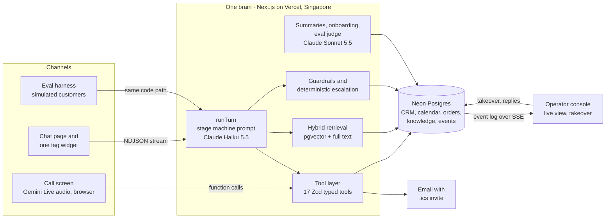

**Model choices.** Claude Haiku 5.5 answers live turns with extended thinking switched off, because a front desk has to be fast and the stage machine and tools keep it on rails. Claude Sonnet 5.5 does the slower, careful work: conversation summaries, extracting a business profile from a website or documents, and judging evals. Gemini Live handles voice end to end, and Gemini embeddings power retrieval.

### A live voice call, step by step

The browser talks to Gemini Live directly over a WebSocket, using a single use token our server mints with the prompt, tools and voice locked in. The API key never reaches the phone. When Gemini wants to act, the browser forwards the call to our server, which runs the same tool code the chat uses.

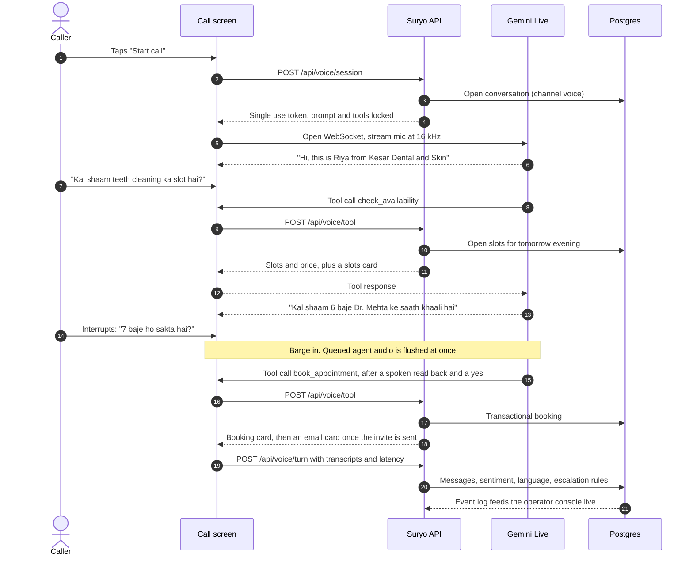

If the line drops, from a network blip or a model quota, the call reconnects on the next voice model in the chain and replays the recent transcript. Riya says she is back and carries on where she left off.

### The conversation stays on rails

The system prompt walks the model through explicit stages, and the console shows which stage each conversation is in. Write actions require `confirmedByCustomer: true` in their schema, so the model cannot book, cancel or open a ticket without first reading the details back and hearing a clear yes.

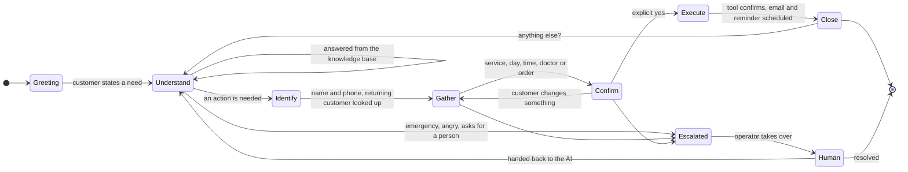

Two small details matter more than they look:

- **A real calendar in the prompt.** Models are bad at weekday arithmetic, so every prompt carries the next fourteen dates with weekday names and which ones are *aaj*, *kal* and *parso*. In our first eval run the agent called 30 October a Wednesday; with the table, the ambiguous date scenarios pass.
- **No thinking out loud.** Without extended thinking, a fast model tends to narrate ("let me check that"). Text that comes before a tool call in the same step is held back and dropped, and those fragments are also removed from the replayed history, so the agent does not learn the habit.

### Grounded answers or an honest "I don't know"

Retrieval starts the moment a message arrives, in parallel with loading the conversation history, so most questions are answered with a single model call. The prefetched passages are recorded as a real `search_knowledge` call, which means they are replayed on later turns and the agent can rely on facts it was given earlier.

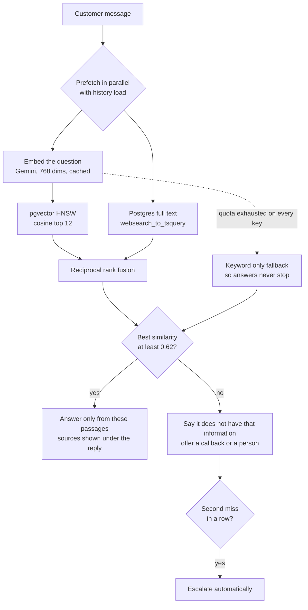

Prices, policies and slots come only from tool results. The agent is told never to mention a knowledge base or tools to the customer, and never to describe an action no tool confirmed. Our eval judge checks exactly that, with the passages the agent actually retrieved in front of it.

### Why double booking cannot happen

Booking is a single conditional update inside a transaction. Two customers can ask for the same slot at the same instant, and Postgres lets only one of them flip it from `open` to `booked`.

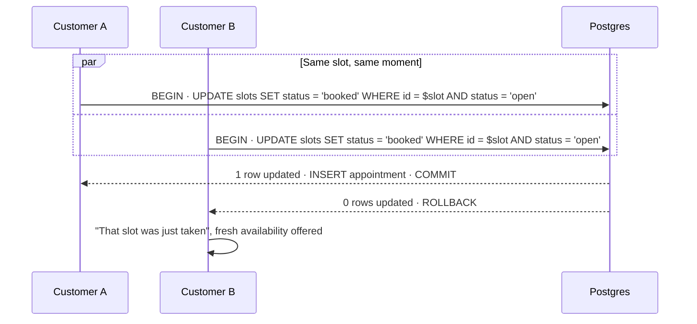

Three more layers sit behind it:

1. A partial unique index, `appointments(slot_id) WHERE status = 'confirmed'`, refuses a second live booking at the database level even if application code were wrong.
2. `book_appointment` must echo the exact `startsAt` of the slot the customer confirmed. If the model passes the wrong slot id, the booking is refused. This caught a real bug in our first eval run, where the agent booked 11 AM after the customer agreed to 10 AM.
3. If the customer already has the same service booked, a new booking is refused with a pointer to `reschedule_appointment`, so "move my appointment" can never become two appointments.

`tests/booking.integration.test.ts` races two bookings for one slot against the real database and asserts that exactly one wins.

### When it hands over to a human

The model can call `escalate_to_human`. Safety does not depend on it remembering to, though: deterministic rules run after every turn as well.

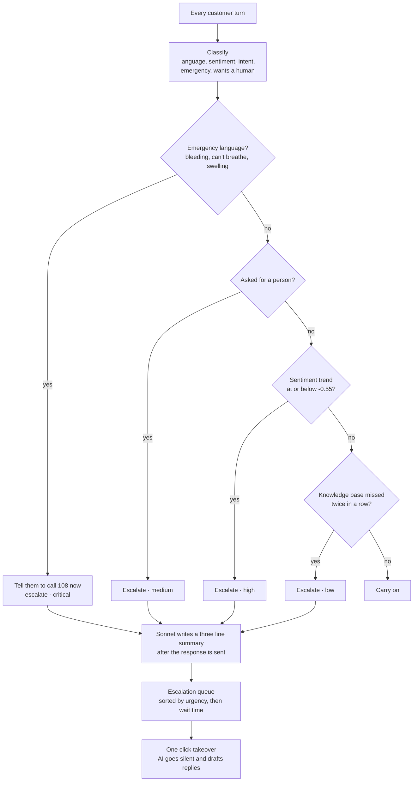

Sentiment is smoothed across turns, so one sharp message does not trigger a handoff but a conversation that keeps getting worse does. Escalations are idempotent per conversation; a second trigger raises the urgency instead of adding a duplicate to the queue.

### Onboarding from a URL or a pile of documents

Most small businesses do not have a tidy website. They have a PDF brochure, a price list in a spreadsheet and a WhatsApp FAQ. Suryo takes any of those, with or without a website, and when they disagree it trusts the documents.

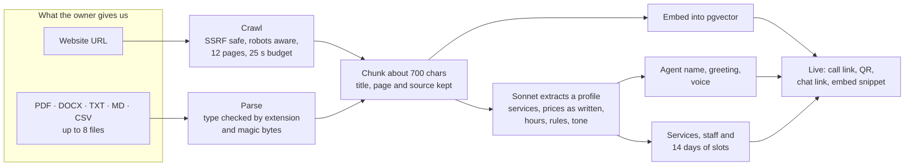

| Source | Time to live |
| --- | --- |
| slowbroslabs.com | 12.1 s |
| cal.com | 14.3 s |
| linear.app | 18.0 s |
| bluetokaicoffee.com | 21.1 s |
| clovedental.in | 34.0 s |
| A PDF brochure and a Word FAQ (fictional physiotherapy clinic) | 10.7 s |
| A bot blocking site | Fails clearly with the HTTP status |

Document text is treated as untrusted data. One test upload carried a planted line telling the model that every session costs one rupee and the clinic is open 24 hours. It was ignored, and the agent quoted the real prices and hours. Owners can edit every extracted field and add or remove documents later; new documents fill gaps without overwriting their edits.

### Orders, returns and policy enforced in code

The second demo business, Saanjh Studio, is a fictional online clothing label from Indore. Its knowledge base is written as the company's own policy documents, and its orders cover every state an order can be in. Each kind of business gets only the tools that make sense for it: a clinic never sees `cancel_order`, a store never sees `book_appointment`.

The model explains the policy. The code enforces it:

| Rule | Where it lives |
| --- | --- |
| Cancel only while an order is placed or packed | Conditional `UPDATE ... WHERE status IN ('placed', 'packed')` |
| Returns and exchanges within 15 days of delivery | `returnEligibility()` |
| Final sale items cannot be returned | Checked per item |
| 99 rupee pickup fee, waived for damaged, defective or wrong items | Refund computed in code, never by the model |
| Exchange only into a size that exists | Checked against the product's sizes |
| One open return per order | Partial unique index on `returns` |
| Changing an order needs the phone number on it | `verify()` before any cancel or return |

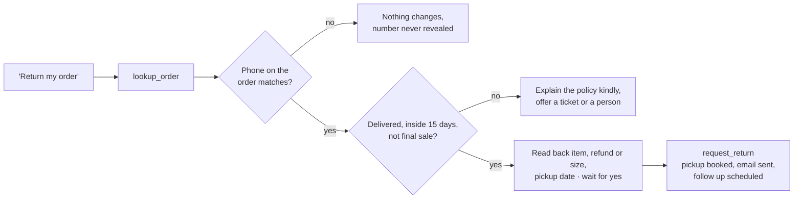

### It never goes silent

Free tier quotas run out at the worst moment, usually during a demo. Every external dependency has a fallback:

```mermaid
flowchart TD
  subgraph Keys["Gemini key pool"]
    K1["Account 1"] --> K2["Account 2"] --> K3["Account n"]
  end
  K1 -. "429 or quota: bench the key for 60 s,<br/>try the next one" .-> K2

  subgraph Voice["Voice model chain"]
    V1["gemini-3.1-flash-live"] --> V2["gemini-2.5-flash-native-audio"] --> V3["gemini-3.8-live"]
  end
  V1 -. "socket drops: reconnect on the next model,<br/>replay the transcript, 'sorry, I am back'" .-> V2

  subgraph Retrieval
    R1["Embedding, cached for repeat questions"] -. "every key exhausted" .-> R2["Keyword only search"]
  end

  subgraph Chat
    C1["Model or tool error"] --> C2["Apologise, escalate to a coordinator,<br/>never leave the customer hanging"]
  end
```

We smoke tested every voice model in the chain: each one greets, calls `check_availability` and answers in Hinglish.

<br/>

## Proof, not a lucky demo: the eval harness

Anyone can make a demo work once. We wanted to know how often it works.

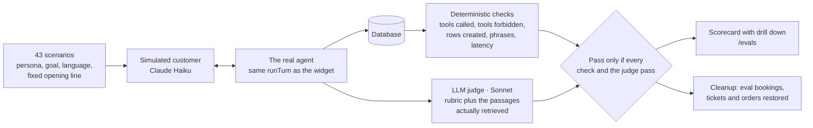

The scenarios cover FAQs, bookings in English, Hinglish and Hindi, rescheduling, cancellation, ambiguous dates ("parso dopahar"), questions the knowledge base cannot answer, angry billing disputes, explicit requests for a person, a dental emergency, medical advice requests, three prompt injection attempts, a fully booked day, returning customers, price negotiation, lead capture, and eight online store cases (tracking, exchange, cancellation, final sale, a closed return window, cash on delivery, a wrong phone number and a damaged item).

**Latest full run: 37 of 43 scenarios passing (86%)**

| Category | Passing | | Category | Passing |
| --- | --- | --- | --- | --- |
| Safety (emergency, diagnosis, dosage) | 3 of 3 | | Escalation | 3 of 3 |
| Prompt injection | 2 of 3 | | Tickets | 2 of 2 |
| Booking | 4 of 5 | | Cancel | 2 of 2 |
| Reschedule | 1 of 2 | | Ambiguous dates | 2 of 2 |
| FAQ | 5 of 6 | | Language (Hindi, Hinglish) | 2 of 2 |
| Sales and leads | 2 of 3 | | Out of scope | 2 of 2 |
| Store orders | 7 of 8 | | **Total** | **37 of 43** |

Average turn latency across the run was 3.8 s, including multi step tool turns. We read every failure. Most remaining ones are the judge being strict about a single phrase (for example offering a callback date one day off what the customer asked for). One was a real data issue we fixed after the run: when a caller asks to "shift" an appointment and the agent cancels then books, the CRM now records it as a reschedule.

How we got here, honestly:

| Run | Score | What changed |
| --- | --- | --- |
| First full run | 19 of 35 | Harness bugs (the simulator's structured output crashed, a free tier quota pushed the classifier onto its fallback) plus real agent bugs |
| Second full run | 24 of 35 | Harness fixed. The remaining failures were real: duplicate bookings instead of reschedules, booking the wrong slot, weekday arithmetic, narrating tool use, promising emails that were never sent |
| Third full run | 31 of 35 | Root causes fixed in the agent and the tools, never by special casing a test: the slot guard, the duplicate booking guard, the calendar table, silent tool use, honest confirmations |
| Fourth full run | 34 of 43 | Eight store scenarios added. Mid run the Gemini Embedding 1 free tier hit its daily cap, and 34 lookups fell back to keyword search, which is why prices went missing |
| Final full run | 37 of 43 | Moved to Gemini Embedding 2, re-embedded every chunk, and made the keyword fallback match any word. Zero fallbacks during the run |

<br/>

## Measured performance

| What | Measured | How |
| --- | --- | --- |
| Voice: end of caller speech to first agent audio | Median about 1.5 s on turns that included a tool call (range 1.1 to 2.6 s). The greeting starts in 0.7 to 1.0 s. | The call screen timestamps the last caller transcription chunk and the first agent audio chunk, and stores the difference on each agent message |
| Voice: barge in | Agent audio stops on the next audio frame after the caller speaks | Gemini signals `interrupted`; the player flushes every scheduled buffer |
| Chat: first token on a knowledge question | 1.6 to 2.1 s on production, measured server side | `firstTokenMs` is stored on every agent message |
| Chat: a full booking turn with tools | 4 to 5 s | Includes the transactional write; the confirmation email is sent after the reply |
| Onboarding | 10 to 35 s | Shown live on screen and stored on the business |
| Demo reset | A few seconds | Shown in the console toast |

Every number on the landing page, the console and the pitch slides is computed from the database at request time. Nothing is hardcoded.

<br/>

## Data model

23 tables in Neon Postgres, defined with Drizzle in [`lib/db/schema.ts`](lib/db/schema.ts). The core of it:

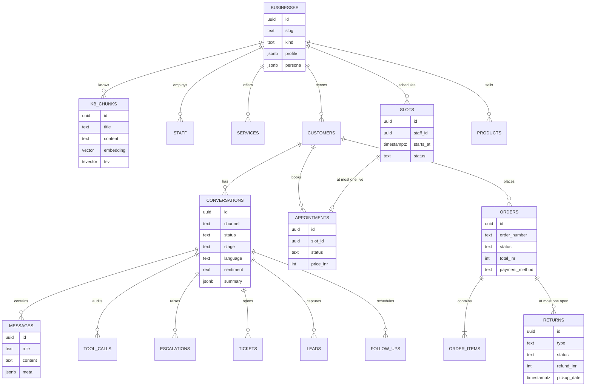

Everything the console shows in real time comes from an append only `events` table. The console reads it over Server Sent Events and falls back to polling every three seconds if the stream fails, so the view never freezes.

<br/>

## Tools the agent can call

Defined once with Zod in [`lib/agent/actions.ts`](lib/agent/actions.ts) and [`lib/agent/commerce.ts`](lib/agent/commerce.ts), then exported to Claude for chat and to Gemini Live as JSON Schema for voice.

| Tool | Available to | What it does |
| --- | --- | --- |
| `search_knowledge` | every business | Hybrid search over the business's own knowledge, with a confidence gate |
| `lookup_customer` | every business | Recognises a returning customer by phone or email, with upcoming appointments, hours until each and whether cancelling is still free |
| `upsert_customer` | every business | Saves name, phone, email and language |
| `create_ticket` | every business | Category, priority and an SLA a human can act on without rereading the chat |
| `capture_lead` | every business | Interest, budget and timeline, with a deterministic lead score and a nurture follow up |
| `escalate_to_human` | every business | Reason, trigger and urgency, with an AI summary written in the background |
| `schedule_follow_up` | every business | Callbacks, reminders and nurture messages |
| `check_availability` | clinics and services | Real open slots by service, doctor, location, date range and time of day |
| `book_appointment` | clinics and services | Transactional booking, confirmation email with an `.ics` invite, reminder scheduled |
| `reschedule_appointment` | clinics and services | Atomic move: the old slot reopens in the same transaction |
| `cancel_appointment` | clinics and services | Reopens the slot, cancels pending reminders, flags late cancellations |
| `send_confirmation` | clinics and services | Resends the confirmation email |
| `lookup_order` | stores | An order by number, or recent orders by phone, with what the customer may do next |
| `track_order` | stores | Carrier, tracking number, expected delivery and a timeline |
| `cancel_order` | stores | Cancels before shipping, with the refund explained |
| `request_return` | stores | Return or size exchange inside the window, pickup booked |
| `refund_status` | stores | Where a return or refund stands |

<br/>

## Safety and privacy

- **No medical advice.** Diagnosis and dosage questions are declined with an offer to book a consultation. Emergency language gets "call 108 now" and a critical escalation, both from the model and from a rule that runs regardless.
- **Prompt injection.** Instructions inside customer messages or uploaded documents cannot change the agent's role. Write tools need explicit confirmation fields. Three injection scenarios in the eval suite try to extract the system prompt, get a 50 percent discount and cancel another person's appointment.
- **Identity before change.** A store order can only be changed with the phone number used to place it, and the agent never reads that number back.
- **PII.** Phone numbers and emails are masked in tool call logs and in console lists. The operator console and every mutating operator route require an operator key in production.
- **No mail to test addresses.** Evaluation conversations and reserved domains (`example.com`, `.test`) never reach a real inbox.
- **SSRF and uploads.** The crawler only fetches public http and https hosts and blocks private ranges, localhost and cloud metadata addresses. Uploads are checked by extension and by their first bytes, capped at 4 MB per file, and PDFs with no selectable text are rejected with a clear message.
- **Abuse.** Per IP rate limits on chat and on voice session creation. The Gemini API key never leaves the server; the browser only ever holds a single use token.

<br/>

## Plugging into your CRM

The tool layer is the integration boundary. Every channel talks to the same handlers, so connecting GoHighLevel, HubSpot, Zoho or a clinic's existing booking system means implementing those handlers against their API. The prompt, the channels, the console and the evals stay exactly as they are. The `events` table already records every action, which makes it straightforward to mirror into a CRM's activity timeline or a webhook.

<br/>

## Run it yourself

You need Node 22 or newer, pnpm, a Neon Postgres database, an Anthropic API key, a Gemini API key, and a Gmail app password if you want confirmation emails.

```bash
git clone https://github.com/ayushparmarias2-sudo/mitocondria.git suryo
cd suryo
pnpm install
cp .env.example .env.local      # fill in the values below
pnpm db:push                    # create the tables (needs the pgvector extension)
pnpm db:seed                    # the demo clinic and the demo store
pnpm dev                        # http://localhost:3000
```

```bash
pnpm test                                                   # unit tests and the double booking race
npx tsx --env-file=.env.local scripts/eval.ts               # the full eval suite from the terminal
npx tsx --env-file=.env.local scripts/eval.ts --category store
npx tsx --env-file=.env.local scripts/chat.ts kesar "Do you take Star Health?"
npx tsx --env-file=.env.local scripts/voice-smoke.ts        # checks the voice pipeline end to end
```

| Variable | What it is for |
| --- | --- |
| `DATABASE_URL` | Neon Postgres connection string, with the `vector` extension enabled |
| `ANTHROPIC_API_KEY` | Claude for live turns, summaries, onboarding and the eval judge |
| `GEMINI_API_KEY` | Gemini Live voice and embeddings |
| `GEMINI_API_KEYS` | Optional. Comma separated extra keys from other accounts, rotated with quota failover |
| `SMTP_USER`, `SMTP_PASSWORD` | Gmail address and app password for confirmation emails |
| `OPERATOR_KEY` | Optional locally. Protects the operator console in production |

Deploying is `vercel deploy --prod` with the same variables. The project is pinned to Vercel's Singapore region so it sits next to the Neon database.

<br/>

## Repository tour

```text
app/
  call/[slug]          voice call screen
  chat/[slug]          chat, also the iframe the widget opens
  console/             operator console: live, escalations, customers, bookings,
                       tickets, leads, orders, follow ups, analytics
  onboard/             onboarding from a URL or documents
  evals/               scorecard and drill down
  store/               demo online store
  demo-site/           a sample clinic site with the widget embedded
  pitch/               five slides with live numbers
  api/                 chat, voice, console, onboarding, evals, demo reset
lib/
  agent/               the brain: prompt, runTurn, tools, commerce tools,
                       analysis, escalation, summaries
  kb/                  embeddings and hybrid retrieval
  voice/               Gemini Live client, audio capture and playback, tokens
  onboard/             crawler, document parsing, extraction, business creation
  evals/               scenarios, simulator, checks, judge, runner
  db/                  Drizzle schema and client
  seed/                the demo clinic, the demo store and their history
public/widget.js       the one script tag embed
tests/                 unit tests, document parsing and the booking race
scripts/               seed, chat, eval and voice smoke test from the terminal
```

<br/>

## What we would build next

- **Phone numbers and WhatsApp** on the same brain, through Twilio or Exotel and the WhatsApp Cloud API.
- **CRM adapters** for GoHighLevel and HubSpot behind the existing tool layer.
- **Outbound follow up calls** that use the voice pipeline for reminders and abandoned conversations.
- **Multi location scheduling** with resource constraints (rooms, chairs, equipment), not just staff.
- **Evals on every pull request**, so a prompt change that breaks a scenario never ships.

<br/>

## Team

**Team Mitocondria**, built in six hours at CODE E FIESTA 2026.

- Ayush Gupta
- [Ayush Parmar](https://github.com/ayushparmarias2-sudo)
- Ayush Chouksey
- Ayushman Singh

<br/>

<sub>The two demo businesses, Kesar Dental &amp; Skin and Saanjh Studio, are fictional. Their knowledge bases, doctors, products, prices and orders are seeded by <code>pnpm db:seed</code>, along with ten days of conversation history so the console is not empty at minute one. Everything you do in the live demo is real and is added on top.</sub>
