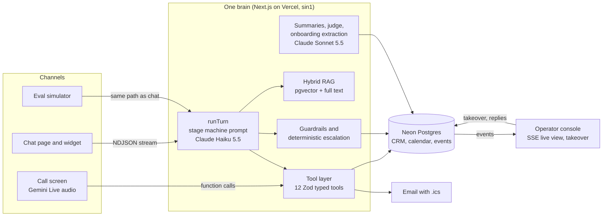

# Suryo

**The front desk that never misses a customer.**

Suryo is an AI customer operations agent. It answers every call and chat in the customer's language (English, Hindi or Hinglish). It grounds every answer in the business's own knowledge and actually books, reschedules, cancels, opens tickets and captures leads. It hands off to a human the moment it should, and closes every loop with a follow up.

Built at CODE E FIESTA 2026 (Medicaps University x SlowBros Labs) for **Problem Statement 03: The AI Customer Operations Agent**.

- Live: https://suryo-eight.vercel.app
- Call the demo clinic: https://suryo-eight.vercel.app/call/kesar (open on a phone, or scan the QR on the home page)
- Chat: https://suryo-eight.vercel.app/chat/kesar
- Operator console: https://suryo-eight.vercel.app/console (operator key required in production)
- Onboard any business from a URL: https://suryo-eight.vercel.app/onboard
- Eval scorecard: https://suryo-eight.vercel.app/evals
- Pitch: https://suryo-eight.vercel.app/pitch

## The problem

Businesses lose customers because calls go unanswered, support requests stay unresolved and follow ups are forgotten. A 411 Locals study tracked 85 small businesses across 58 industries for 30 days and found 62 percent of incoming calls went unanswered ([summary of the study](https://getaira.io/blog/missed-business-calls-statistics)). The sample is small and the study is several years old, so treat it as directional. Larger studies that include firms with call centres report lower miss rates, around 22 percent.

## What it does

| Capability | How it works |
| --- | --- |
| Voice in the browser | Gemini Live native audio, speech to speech, streamed both ways from the browser with a single use ephemeral token. True barge in: the moment the caller speaks, queued agent audio is flushed. Live captions, action cards and a canvas visualiser that reacts to both voices. |
| Chat and embeddable widget | One script tag: `<script src="https://suryo-eight.vercel.app/widget.js" data-business="kesar" async></script>`. Streaming replies, slot picker cards, booking, ticket, lead and email cards, and source chips for grounded answers. |
| One brain | Chat, voice and the eval harness all call the same 12 tools in `lib/agent/actions.ts` against the same Postgres database. A caller who chatted yesterday is recognised by phone number today. |
| Grounded answers | Hybrid retrieval: pgvector cosine (HNSW) plus Postgres full text, fused with reciprocal rank fusion. Below a confidence threshold the agent says it does not know and offers a human or a callback. Two misses in a row escalate automatically. |
| Real actions | Transactional booking, rescheduling and cancelling. Tickets with priority and SLA, leads with a deterministic score, confirmation email with an `.ics` calendar invite, and reminders and follow ups scheduled automatically. |
| Read back before acting | Every write tool requires `confirmedByCustomer: true`, and the prompt requires reading the details back and hearing an explicit yes first. |
| Escalation | The model can call `escalate_to_human`. Deterministic rules also run after every turn, so safety never depends on the model remembering: emergency language, explicit human requests, a negative sentiment trend and repeated low confidence. Escalations carry a 3 line AI summary. |
| Human takeover | The operator console shows every live conversation with transcript, language, intent, sentiment trend, stage and tool calls as they happen (SSE with polling fallback). One click takes over: the AI goes silent and drafts replies the human can send. |
| Never forgets a follow up | Every booking schedules a reminder. Leads get a nurture follow up. Abandoned conversations are detected and get a recovery message. Every conversation ends with a structured summary. |
| 60 second onboarding | Paste a URL. Suryo crawls the site (SSRF safe, robots aware, page and time capped), chunks and embeds it, extracts a structured business profile and persona, creates a bookable calendar, and returns a call link, QR code and embed snippet. |
| Evaluation harness | 33 scenarios played by an LLM simulated customer through the real agent path. Scored by deterministic checks (tools, database state, forbidden phrases, latency) plus an LLM judge. Results are on the scorecard page. |

## Architecture



## Tools

`search_knowledge`, `check_availability`, `lookup_customer`, `upsert_customer`, `book_appointment`, `reschedule_appointment`, `cancel_appointment`, `create_ticket`, `capture_lead`, `send_confirmation`, `escalate_to_human`, `schedule_follow_up`.

The tool layer is a clean adapter boundary. A GoHighLevel or HubSpot integration means implementing the same handlers against their APIs, without touching the prompt or channels.

## Safety model

- **Double booking is impossible.** Booking flips a slot from `open` to `booked` with a conditional `UPDATE ... WHERE status = 'open'` inside a transaction. A partial unique index on `appointments(slot_id) WHERE status = 'confirmed'` backs this up at the database level. `tests/booking.integration.test.ts` races two bookings for the same slot against the real database, and exactly one wins.
- **No hallucinated facts.** Prices, policies and slots come only from tool results. The model is told to say it does not know when retrieval confidence is low.
- **No medical advice.** Diagnosis and dosage questions are declined with an offer to book a consultation. Emergency language triggers 108 guidance and a critical escalation, both from the model and from a deterministic rule.
- **Prompt injection resistance.** Instructions inside customer messages cannot change the role. Write tools need explicit confirmation fields.
- **PII.** Phone numbers and emails are masked in tool call logs and in console lists. The operator console and all mutating operator routes require an operator key in production.
- **Abuse.** Per IP rate limits on chat and voice session creation.

## Measured latency

Measured on real traffic rather than estimated:

- Chat, first token, FAQ answered from prefetched knowledge: about 1.8 to 2.2 s end to end from India to Vercel sin1.
- Voice, end of caller speech to first agent audio: median about 1.5 s across browser test turns that each included a tool round trip (range 1.1 to 2.6 s). This includes a deliberate 550 ms silence window, so Hindi speakers who pause mid sentence are not cut off. The greeting starts in 0.7 to 1.0 s.

How it is measured: the call screen timestamps the last caller transcription chunk and the first agent audio chunk, and stores the difference on each agent message. Chat stores `firstTokenMs` and `latencyMs` on every agent message. The console analytics page reports averages from those rows.

## Evaluation results

EVAL_RESULTS_PLACEHOLDER

## Data

The demo business, Kesar Dental & Skin in Indore, is fictional. Its knowledge base, doctors, prices and 14 days of slots are seeded by `pnpm db:seed`. The console also starts with seeded conversation history from the past 10 days, so the analytics are not empty at minute one. Everything you do live is real and is added on top. The "Reset demo" button restores the seeded state in a few seconds.

## Run locally

```bash
pnpm install
cp .env.example .env.local   # fill in the keys below
pnpm db:push                 # create tables (needs the pgvector extension)
pnpm db:seed                 # seed the demo clinic
pnpm dev                     # http://localhost:3000
pnpm test                    # unit tests plus the double booking race test
npx tsx --env-file=.env.local scripts/eval.ts   # run the eval suite from the CLI
```

Environment: `DATABASE_URL` (Neon Postgres with pgvector), `ANTHROPIC_API_KEY`, `GEMINI_API_KEY` (voice and embeddings), `SMTP_USER` and `SMTP_PASSWORD` (Gmail app password for confirmations), and optionally `OPERATOR_KEY` (protects the console).

## Stack

Next.js 16 App Router, React 19, TypeScript strict, Tailwind CSS v4, Motion, AI SDK 7 with Anthropic and Google providers, Gemini Live (`@google/genai`), Neon Postgres with Drizzle ORM and pgvector, nodemailer with `ics`, Vitest.

## Team

TEAM_PLACEHOLDER
